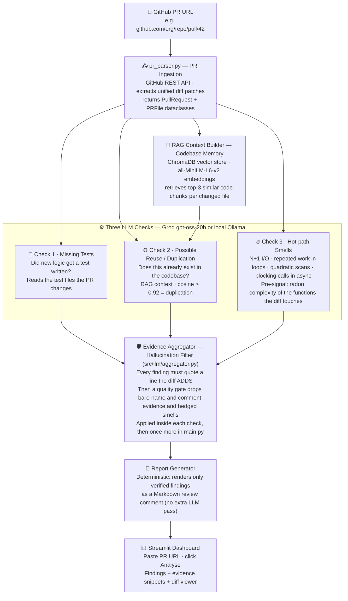

# Architecture - pr-rakshaka

## What it is

pr-rakshaka is an LLM-powered pull request reviewer. It takes a GitHub PR URL, reads the actual code diff, and makes intelligent judgments about three critical review concerns, not with regex rules, but with a language model that understands what the code does and why.

The LLM is the brain of the system, not a formatter bolted on at the end.

---

## How it works end-to-end




---

## Module map

```
pr-rakshaka/
├── .env.example                  # Environment-variable template; no real secrets
├── .gitignore
├── README.md                     # Project overview and usage notes
├── changelog.template
├── main.py                       # Runs the three checks, final evidence pass, writes the report
├── app.py                        # Streamlit web app (demo limits when DEMO_MODE=1)
├── pytest.ini
├── requirements.txt
│
├── docs/
│   └── architecture.md           # This document
│
├── data/
│   └── chromadb/                 # Local generated index; must remain gitignored
│
├── scratch/
│   └── retriever_queries/        # Manual retrieval queries for development
│
├── src/
│   ├── ingestion/
│   │   ├── __init__.py
│   │   ├── pr_parser.py          # GitHub REST API; PullRequest and PRFile
│   │   └── diff_defs.py          # Extract function/class definitions added by a diff
│   │
│   ├── rag/
│   │   ├── __init__.py
│   │   ├── indexer.py            # Build/update repository code embeddings in ChromaDB
│   │   ├── retriever.py          # Retrieve similar indexed code chunks
│   │   └── fingerprint.py        # Normalise code and detect structural copies
│   │
│   ├── checks/
│   │   ├── __init__.py
│   │   ├── missing_tests.py      # Check 1: changed behaviour without relevant tests
│   │   ├── reuse_detector.py     # Check 2: duplicate/reusable repository functionality
│   │   ├── hot_path_smells.py    # Check 3: LLM review of performance risks
│   │   └── smell_catalog.py      # Check 3 smell definitions and optional Radon signals
│   │
│   ├── llm/
│   │   ├── __init__.py
│   │   ├── client.py             # Local Ollama / Groq provider, JSON handling and stats
│   │   ├── prompts.py            # Check-specific system prompts and prompt builders
│   │   ├── compare.py            # Run one operation with providers and compare telemetry
│   │   └── aggregator.py         # Finding structure and evidence-only filtering
│   │
│   └── report/
│       ├── __init__.py
│       └── generator.py          # CheckResult / Review dataclasses and render_markdown()
│
├── evaluation/                   # Real-PR evaluation (see evaluation/RESULTS.md)
│   ├── eval_set.csv              # 68 labelled PRs, one row per check
│   ├── split.json                # dev/test split, made once, with test fingerprint
│   ├── collect_candidates.py     # find PRs where a reviewer raised a concern
│   ├── label_candidates.py       # interactive labelling
│   ├── snapshot.py               # rebuild a PR at the commit the reviewer saw
│   ├── run_eval.py               # run the checks over a split (test needs --final, once)
│   ├── score.py                  # recall, precision, silence; writes judgements.csv
│   ├── runs/                     # saved per-PR reviews, by split and provider
│   ├── judgements.csv            # blind verdicts on findings that matched no label
│   └── RESULTS.md                # results, debugging log, limitations
│
└── tests/
    ├── __init__.py
    ├── unit/
    │   ├── test_smell_catalog.py
    │   ├── test_hot_path_smells.py
    │   ├── test_compare_check3_fixtures.py
    │   ├── test_aggregator.py
    │   ├── test_report_generator.py
    │   ├── test_main.py
    │   ├── test_app.py
    │   ├── test_evaluation.py
    │   └── test_dev_fixes.py
    └── integration/
        ├── compare_check1.py     # Known-answer Check 1 fixtures
        ├── compare_check2.py     # Known-answer Check 2 fixtures
        └── compare_check3.py     # Known-answer Check 3 fixtures (under development)
```
The module map gives an idea of the layout and may lag the repo slightly.
---

## Key design decisions

**LLM as reviewer, not classifier**
The model reads actual diffs and makes judgments the way a senior engineer would, not by matching patterns. A regex can tell you "no test file was touched." Only an LLM can tell you "this new branch in `_validate_input()` is the kind of logic that breaks silently under edge inputs and needs a test."

**RAG for codebase awareness**
Without RAG, the LLM only sees the diff and has no idea what the rest of the codebase looks like. RAG closes that gap: when a PR adds a `calculate_similarity()` function, the LLM gets told that `utils/math.py` already exports one with the same signature. Now it can say something meaningful.

**Evidence-only principle**
Any finding not grounded in a specific line from the diff is dropped before it reaches the user. This is not optional. Hallucinated findings destroy trust in a code review tool faster than missing a real one.

**Deterministic report**
The report generator does not call a model. Every sentence in it is either a finding that already passed the evidence filter or a fact about the run (which checks ran, token counts, how many findings were dropped). A summarising model could add claims nobody verified.

**Static analysis as a hint, not the answer**
radon runs before the smell check and its complexity numbers go into the prompt as context, not out as findings. A high score reaches the model as: *"radon flagged this function at complexity 12 - does the diff justify it?"* The LLM decides. The tool just provides numbers.

**A real quote can still be a poor finding**
Real-PR evaluation showed models quoting genuine lines that point at nothing: a bare identifier, a comment, or a hedge such as "could be expensive if the data is large". After the evidence filter, a small deterministic gate drops those shapes and caps missing-tests findings at two per file. It is a stopgap: some hedges still pass (see `evaluation/RESULTS.md`).

**Evaluated on snapshots, not final diffs**
A merged PR's diff usually already contains the fix a reviewer asked for, and an index of the current code already contains the function being added. The evaluation therefore rebuilds each PR at the commit the reviewer saw and indexes the repository at the PR's base commit. Index builds carry a marker while unfinished so a half-built index is never mistaken for a complete one.

---

## Tech stack

| Layer | Tool | Role |
|---|---|---|
| PR ingestion | GitHub REST API + requests | Fetch diffs and metadata |
| Embeddings | sentence-transformers (all-MiniLM-L6-v2) | Encode code chunks for RAG |
| Vector store | ChromaDB | Persist + retrieve similar code |
| LLM | Groq API (`openai/gpt-oss-20b`, free) or local Ollama (Qwen) | All three checks (the report is deterministic, no LLM) |
| Orchestration | Plain Python (`main.py`) | Runs the checks, no framework |
| Pre-filter | radon (complexity) | Signal fed into the smell prompt |
| UI | Streamlit | Dashboard |
| Language | Python 3.11 | Everything |
