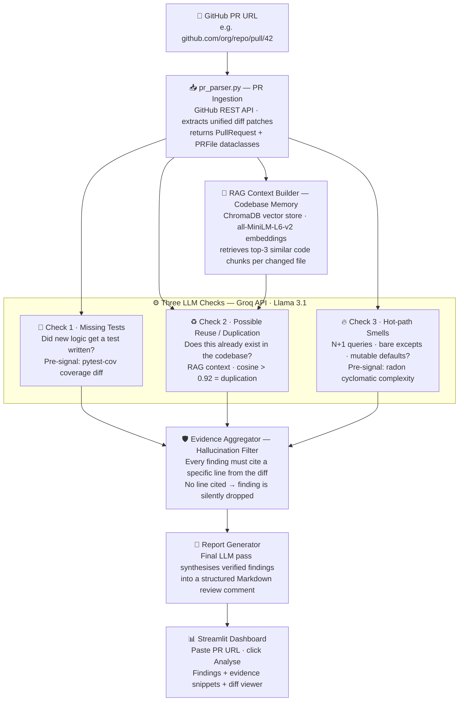

# Architecture - pr-rakshaka

## What it is

pr-rakshaka is an LLM-powered pull request reviewer. It takes a GitHub PR URL, reads the actual code diff, and makes intelligent judgments about three critical review concerns, not with regex rules, but with a language model that understands what the code does and why.

The LLM is the brain of the system, not a formatter bolted on at the end.

---

## How it works end-to-end




---

## Module map

```
pr-rakshaka/
├── .env.example                  # Environment-variable template; no real secrets
├── .gitignore
├── README.md                     # Project overview and usage notes
├── changelog.template
├── main.py                       # Planned full-pipeline entry point; not yet wired
├── requirements.txt
│
├── docs/
│   └── architecture.md           # This document
│
├── data/
│   └── chromadb/                 # Local generated index; must remain gitignored
│
├── scratch/
│   └── retriever_queries/        # Manual retrieval queries for development
│
├── src/
│   ├── ingestion/
│   │   ├── __init__.py
│   │   ├── pr_parser.py          # GitHub REST API; PullRequest and PRFile
│   │   └── diff_defs.py          # Extract function/class definitions added by a diff
│   │
│   ├── rag/
│   │   ├── __init__.py
│   │   ├── indexer.py            # Build/update repository code embeddings in ChromaDB
│   │   ├── retriever.py          # Retrieve similar indexed code chunks
│   │   └── fingerprint.py        # Normalise code and detect structural copies
│   │
│   ├── checks/
│   │   ├── __init__.py
│   │   ├── missing_tests.py      # Check 1: changed behaviour without relevant tests
│   │   ├── reuse_detector.py     # Check 2: duplicate/reusable repository functionality
│   │   ├── hot_path_smells.py    # Check 3: LLM review of performance risks
│   │   └── smell_catalog.py      # Check 3 smell definitions and optional Radon signals
│   │
│   ├── llm/
│   │   ├── __init__.py
│   │   ├── client.py             # Local Ollama / Groq provider, JSON handling and stats
│   │   ├── prompts.py            # Check-specific system prompts and prompt builders
│   │   ├── compare.py            # Run one operation with providers and compare telemetry
│   │   └── aggregator.py         # Finding structure and evidence-only filtering
│   │
│   └── report/
│       └── __init__.py           # Report package placeholder; generator is planned
│
└── tests/
    ├── __init__.py
    ├── unit/
    │   ├── test_smell_catalog.py
    │   └── test_hot_path_smells.py
    └── integration/
        ├── compare_check1.py     # Known-answer Check 1 fixtures
        ├── compare_check2.py     # Known-answer Check 2 fixtures
        └── compare_check3.py     # Known-answer Check 3 fixtures (under development)
```
The module map is present to prvide and idea and may not describe the current repo structure accurately.
---

## Key design decisions

**LLM as reviewer, not classifier**
The model reads actual diffs and makes judgments the way a senior engineer would, not by matching patterns. A regex can tell you "no test file was touched." Only an LLM can tell you "this new branch in `_validate_input()` is the kind of logic that breaks silently under edge inputs and needs a test."

**RAG for codebase awareness**
Without RAG, the LLM only sees the diff and has no idea what the rest of the codebase looks like. RAG closes that gap: when a PR adds a `calculate_similarity()` function, the LLM gets told that `utils/math.py` already exports one with the same signature. Now it can say something meaningful.

**Evidence-only principle**
Any finding not grounded in a specific line from the diff is dropped before it reaches the user. This is not optional. Hallucinated findings destroy trust in a code review tool faster than missing a real one.

**Static analysis as pre-filter, not the answer**
radon and pytest-cov are run before the LLM and their signals are passed into the prompt as context, not returned as findings directly. A high cyclomatic complexity score goes into the smell prompt as: *"radon flagged this function at complexity 12 - does the diff justify it?"* The LLM decides. The tool just provides numbers.

---

## Tech stack

| Layer | Tool | Role |
|---|---|---|
| PR ingestion | GitHub REST API + requests | Fetch diffs and metadata |
| Embeddings | sentence-transformers (all-MiniLM-L6-v2) | Encode code chunks for RAG |
| Vector store | ChromaDB | Persist + retrieve similar code |
| LLM | Groq API — Llama 3.1 8B (free) | All three checks + report synthesis |
| Orchestration | LangChain | RAG chain + prompt management |
| Pre-filters | radon (complexity), pytest-cov (coverage) | Signals fed into LLM prompts |
| UI | Streamlit | Dashboard |
| Language | Python 3.11 | Everything |
